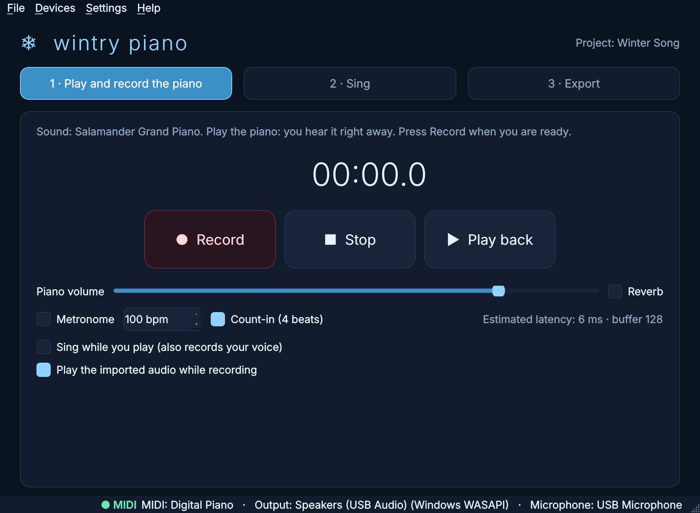
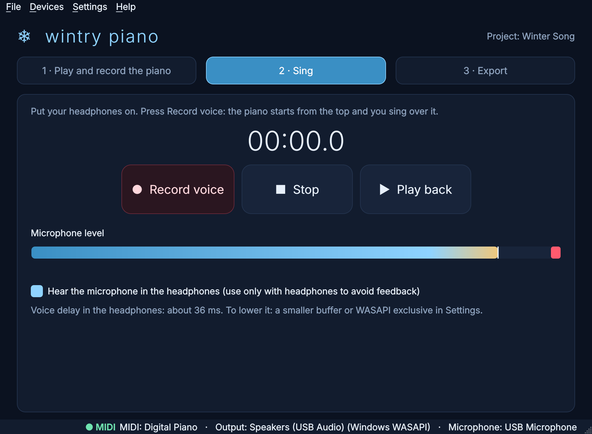
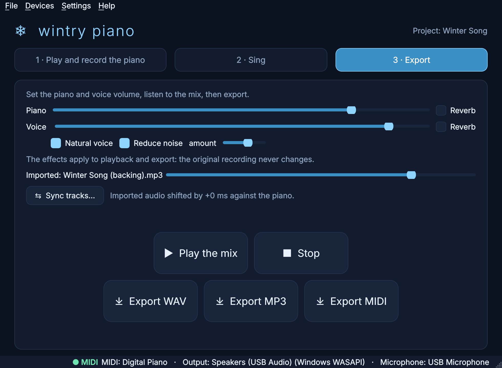
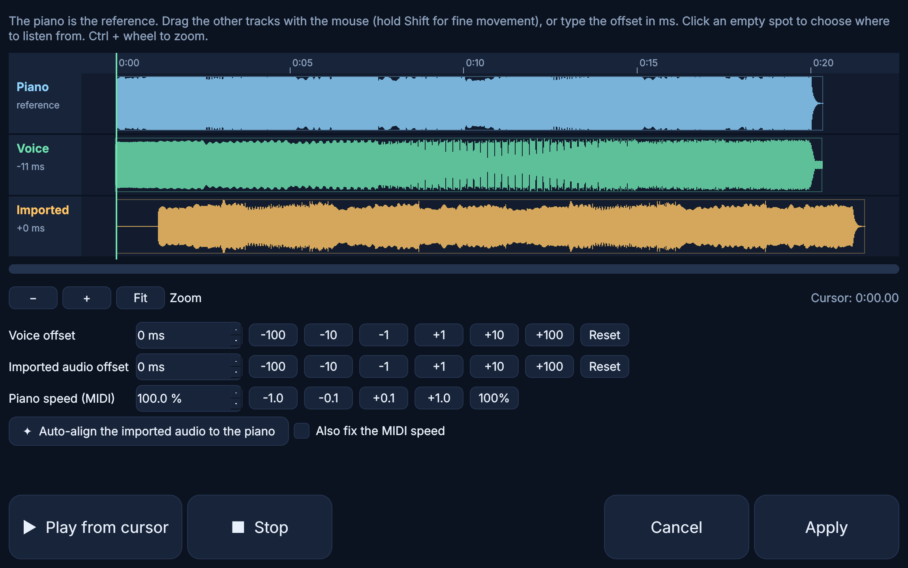
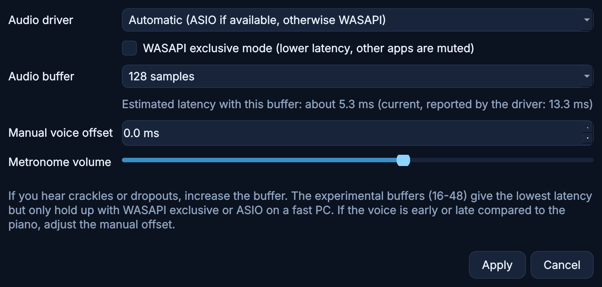

# ❄ wintry piano

**Play a USB MIDI piano with a realistic grand piano sound, record it, sing over it and export the mix. All of it happens in one Windows app, with no DAW and no VST plugins.**



wintry piano is a desktop app for Windows 10 and 11. It is built for one job: playing and singing your own songs. You record the piano as MIDI and your voice as audio, and they stay in time automatically. Then you export a finished WAV, MP3 or MIDI file. The workflow has three steps:

1. **Play and record the piano**
2. **Sing**
3. **Export**

---

## Contents

- [Features](#features)
- [Requirements](#requirements)
- [Installation](#installation)
- [Getting started](#getting-started)
- [Importing a MIDI file or a song](#importing-a-midi-file-or-a-song)
- [Voice effects](#voice-effects)
- [Latency, sync and monitoring](#latency-sync-and-monitoring)
- [Settings](#settings)
- [Projects and files](#projects-and-files)
- [Piano sounds and licenses](#piano-sounds-and-licenses)
- [Building a standalone .exe](#building-a-standalone-exe)
- [Development](#development)
- [Troubleshooting](#troubleshooting)

---

## Features

- **Realistic grand piano.** The app ships with the Salamander Grand Piano (a sampled Yamaha C5) and the lighter YDP Grand Piano, and you can load any `.sf2`/`.sf3` soundfont. It has a sustain pedal, velocity and an optional reverb.
- **Low-latency live playing.** It uses ASIO when available and otherwise WASAPI, optionally in exclusive mode. Buffers go from 1024 samples down to experimental 16-sample sizes.
- **Lossless piano takes.** The piano is recorded as MIDI (`piano.mid`), so you can change the piano sound afterwards without playing the take again.
- **Voice recording** over the piano, or **play and sing in the same take**.
- **Automatic sync.** Every note is stamped at the moment you hear it, and the voice is shifted by the latency the driver reports, so piano and voice line up without any manual work.
- **Hear yourself while you sing.** Real-time headphone monitoring adds only about one buffer of delay.
- **Import a MIDI file or a song** (MP3, WAV, FLAC, OGG, and M4A with ffmpeg). The **Sync tracks** editor has waveforms, drag-to-align, millisecond nudges and **auto-align**, which can also correct the MIDI tempo.
- **Voice effects** for playback and export. *Natural voice* applies EQ, a de-esser and a compressor, and *Reduce noise* is a spectral denoiser. The original recording is never modified.
- **Mixer and export** to WAV (24-bit), MP3 or MIDI. Clipping is prevented automatically (the peak stays at −1 dBFS).
- **Metronome and count-in.** The metronome is never recorded.
- **Crash recovery.** Takes are journaled to disk while you record and can be recovered at the next start.
- **Plug and play.** MIDI and audio devices can be connected or disconnected at any time, and the app reconnects automatically.
- **One-click installer** that sets up Python, the libraries, ffmpeg, the piano sounds and a desktop shortcut.

## Requirements

- Windows 10 or 11, 64-bit.
- A USB MIDI keyboard or digital piano. You can also try everything without one in demo mode.
- Headphones, for recording the voice.
- About 1.5 GB of disk space and 8 GB of RAM for the Salamander piano. The YDP piano runs fine with less.
- **Python 3.12.** The installer takes care of it. python-rtmidi and tinysoundfont do not yet ship prebuilt wheels for Python 3.13 on Windows, so 3.12 is required.

## Installation

1. Download or clone this repository.
2. Double-click **`install.bat`**. The installer:
   - installs 64-bit Python 3.12 if it is missing (with winget, the python.org setup, or the official zip package as a fallback);
   - creates a `.venv` environment and installs every library;
   - installs ffmpeg for MP3 export (with winget, or into `ffmpeg\` if winget is not available);
   - downloads the piano sounds: Salamander Grand Piano (~296 MB) and YDP Grand Piano (~36 MB);
   - creates a **Wintry Piano** shortcut on the desktop.
3. Start the app from the shortcut, or run **`start.py`** (double-click it, or run `.venv\Scripts\python.exe start.py`).

You can run `install.bat` again at any time. Steps that are already complete are skipped.

| Installer option | Effect |
|---|---|
| `-YdpOnly` | Download only the light YDP piano |
| `-NoFFmpeg` | Skip ffmpeg (WAV export still works) |
| `-NoShortcut` | Do not create the desktop shortcut |
| `-FFmpegZip` | Download ffmpeg as a zip instead of using winget |
| `-PythonNuGet` | Install Python from the official zip package instead of the setup |

For example: `install.bat -YdpOnly`.

To try the app without a piano connected, run `start.py --demo` or turn on **Settings → Demo mode**. A virtual pianist then plays for you.

## Getting started

### 1 · Play and record the piano

Choose your piano in **Devices → MIDI input** (by default every input is listened to) and your headphones in **Devices → Audio output**. Play: you hear the piano right away. Press **Record** to start a take, **Stop** to end it and **Play back** to listen.

- Use **Piano volume**, **Reverb**, **Metronome** (with bpm) and **Count-in** to shape the take.
- **Sing while you play** records the microphone in the same take. The piano goes to `piano.mid` and the voice to `voice.wav`, already aligned. Use headphones so the piano does not leak into the microphone.

### 2 · Sing



Put your headphones on and press **Record voice**. The piano starts from the top and you sing over it. The microphone meter warns you if the input clips. You can redo the voice as many times as you like: the piano take is never touched.

### 3 · Export



Balance the piano and voice, add reverb, turn on the voice effects and listen with **Play the mix**. Then export:

- **Export WAV**: 24-bit stereo mix.
- **Export MP3**: requires ffmpeg, which the installer sets up.
- **Export MIDI**: the piano alone, as a standard `.mid` file for any other program.

## Importing a MIDI file or a song

The **File** menu can bring outside material into a project.

- **Import MIDI as piano…** uses a `.mid` file as the piano take. Every channel except drums is played with your piano sound, and the tempo is read from the file.
- **Import audio (MP3, WAV…)…** adds a song or a backing track as a separate track. It has its own volume in step 3, is included in the mix and the export, and can play while you record the piano or the voice. You can turn that off in step 1.
- **Sync tracks…** opens the sync editor:



The piano is the reference. Drag the other tracks with the mouse (hold Shift for fine movement), type an offset in milliseconds, or use the nudge buttons. Click an empty spot to choose where playback starts, and use Ctrl + wheel to zoom.

**Auto-align** compares the MIDI notes with the onsets in the imported audio and finds the right offset. With **Also fix the MIDI speed** it also finds a tempo correction between 80% and 125%, which is useful when the MIDI and the recording run at slightly different tempos.

## Voice effects

The effects in step 3 apply to playback and export only. `voice.wav` always stays the original, untouched recording.

- **Natural voice** shapes the voice in four ways:
  - an 80 Hz high-pass filter;
  - less low-mid mud;
  - more presence and air;
  - a de-esser for harsh "s" sounds and a gentle compressor, so the voice sounds more alive and even.
- **Reduce noise** removes steady background hiss, such as fans or room noise. The **amount** slider sets how strong it is. The noise profile is learned from the quietest parts of the take.

## Latency, sync and monitoring

- **Piano and voice stay in time.** Each note is recorded at the moment you hear it, because the output latency and the callback wait are removed. The voice is then shifted by the input and output latency the driver reports. If you still hear a constant offset, correct it once in **Settings → Manual voice offset**.
- **Hear yourself in the headphones** (step 2, and step 1 with *Sing while you play*). The monitor adds only one audio buffer on top of the driver latency, and the app shows the resulting delay in milliseconds. If the system cannot keep up, the safety margin grows automatically instead of crackling.
- **Lowest latency.** Use ASIO if your audio interface has a driver for it. Otherwise use **WASAPI exclusive mode** with a small buffer. To find the smallest stable buffer on your PC, close the app and run:

  ```bat
  .venv\Scripts\python -m wintrypiano.audio.latency_test --include-exclusive --save
  ```

  Add `--experimental` to also try the 48, 32 and 16-sample buffers.

## Settings



| Setting | What it does |
|---|---|
| Audio driver | Automatic (ASIO if available, otherwise WASAPI), or a specific driver |
| WASAPI exclusive mode | Lower latency. Other apps are muted while wintry piano is open |
| Audio buffer | 16–2048 samples, with the estimated latency. The 16–48 sizes are experimental |
| Manual voice offset | A fixed correction, in ms, if the voice is consistently early or late |
| Metronome volume | Volume of the click and the count-in |

Device choices live in the **Devices** menu and are remembered between sessions. **Settings → Piano sound…** lets you switch between the bundled pianos or load your own `.sf2`/`.sf3` file.

## Projects and files

Each project is a folder. By default it lives in `Documents\Wintry Piano`.

```
project.json    settings (bpm, volumes, reverb, effects, latency compensation, sync offsets…)
piano.mid       the piano take
voice.wav       the voice take (mono, without effects)
backing.flac    the imported audio, if any (converted once on import)
.recovery/      journal files written while recording
```

The app always asks before it overwrites a take. While you record, the piano and voice are written to `.recovery/` continuously. If the app or the PC crashes, the take is offered for recovery at the next start.

Projects created by earlier versions (`progetto.json`, `voce.wav`, `base.flac`) are renamed automatically when they are opened.

The settings and the log file are stored in `%APPDATA%\WintryPiano\`. The log is `wintrypiano.log`.

## Piano sounds and licenses

| Sound | License | Notes |
|---|---|---|
| Salamander Grand Piano V3 (Yamaha C5, by Alexander Holm; SF2 conversion by FreePats) | CC BY 3.0 | The default and most realistic sound. It uses about 1.2 GB on disk and 2.5 GB of RAM, so prefer YDP on PCs with less than 8 GB |
| YDP Grand Piano (FreePats) | CC BY 3.0 | Lighter |

Source: <https://freepats.zenvoid.org/Piano/acoustic-grand-piano.html>

CC BY 3.0 allows redistribution with attribution. The credits are shown in **Help → About and credits**, and a `*-CREDITS.txt` file is written next to each soundfont. The soundfonts are not stored in this repository because they exceed GitHub's 100 MB file limit. They are downloaded by the installer, by the app on first start (if missing) and by `build_exe.bat`.

Third-party libraries:

- PySide6 (LGPL)
- mido and python-rtmidi (MIT)
- sounddevice (MIT) with PortAudio
- soundfile (BSD) with libsndfile (LGPL)
- tinysoundfont (MIT)
- NumPy (BSD)

## Building a standalone .exe

After running `install.bat`, run **`build_exe.bat`**. It is equivalent to:

```bat
.venv\Scripts\python -m pip install "pyinstaller>=6.10"
.venv\Scripts\python -m wintrypiano.soundfonts.download --dest assets\soundfonts
.venv\Scripts\python -m PyInstaller --noconfirm --clean --windowed --name "Wintry Piano" ^
  --add-data "assets;assets" --collect-binaries tinysoundfont ^
  --hidden-import mido.backends.rtmidi --hidden-import rtmidi start.py
```

The result is `dist\Wintry Piano\Wintry Piano.exe`, with the piano sounds bundled. The build uses folder mode rather than `--onefile`, because the soundfont is hundreds of MB and would otherwise be extracted on every start.

PyInstaller's hooks pick up the native binaries, and the script checks that they are present:

- `_sounddevice_data\portaudio-binaries\libportaudio64bit.dll` and `libportaudio64bit-asio.dll` (PortAudio, with and without ASIO)
- `_soundfile_data\libsndfile_x64.dll` (libsndfile)
- `tinysoundfont\_tinysoundfont.cp312-win_amd64.pyd`
- `rtmidi\_rtmidi.cp312-win_amd64.pyd`, which uses Windows' `winmm.dll`
- the Qt 6 DLLs from PySide6
- optionally `ffmpeg.exe` next to the exe, for MP3 export when ffmpeg is not on the PATH

## Development

```bat
.venv\Scripts\python -m pip install -r requirements-dev.txt
.venv\Scripts\python -m pytest
```

The test suite needs no hardware. It builds a tiny `.sf2` on the fly and covers:

- projects and legacy migration;
- MIDI files and import;
- soundfont rendering;
- mixing and export;
- audio import and automatic alignment, including tempo;
- crash recovery;
- the voice effects;
- the real-time engine: count-in, metronome, latency compensation and monitoring.

`tests/test_gui_smoke.py` drives the whole GUI flow in demo mode and runs only when an audio device is available. On CI, GitHub Actions runs the tests on Windows, runs the installer on a clean machine, and loads the Salamander piano.

### Code structure

```
start.py              launcher (re-runs itself with the .venv Python)
install.bat           installer entry point -> installer/install.ps1
build_exe.bat         PyInstaller build
wintrypiano/
  app.py              application entry point and logging
  config.py           user settings (%APPDATA%\WintryPiano\settings.json)
  audio/              device discovery (ASIO/WASAPI), real-time engine, latency test
  midi/               USB MIDI input with hot-plug, demo player
  core/               synthesizer, reverb, metronome, MIDI files, mixer, export,
                      project, crash recovery, audio/MIDI import, alignment, voice FX
  soundfonts/         piano catalog and downloader
  gui/                main window, sync editor, settings, sound picker, theme
tests/                pytest suite (no hardware required)
```

## Troubleshooting

| Problem | What to try |
|---|---|
| No sound from the piano | Check **Devices → Audio output** and that the MIDI light flashes when you play |
| Crackles or dropouts | Increase the buffer in **Settings**, or turn off exclusive mode |
| The voice is not recorded or the meter does not move | Pick the right microphone in **Devices → Microphone** |
| The voice is slightly early or late | Set **Settings → Manual voice offset**, or fine-tune it in **Sync tracks** |
| MP3 export is unavailable | Run `install.bat` again to install ffmpeg, or export WAV |
| Something else | Look at `%APPDATA%\WintryPiano\wintrypiano.log` |
